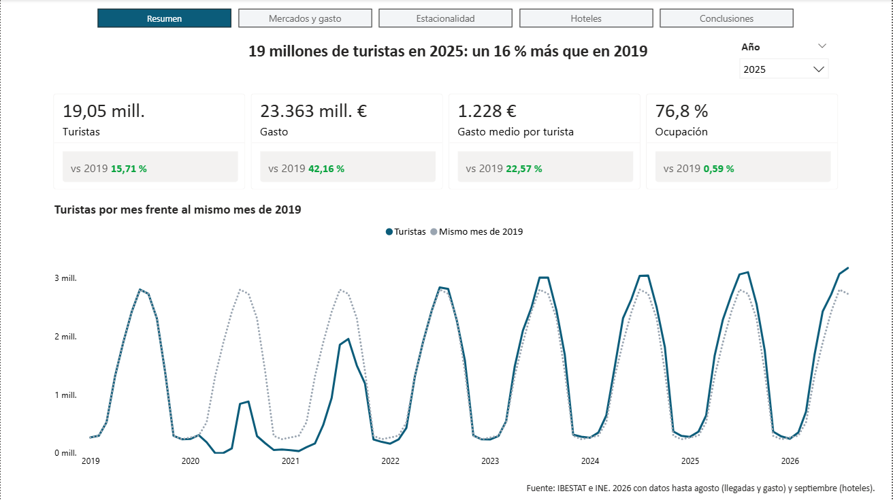
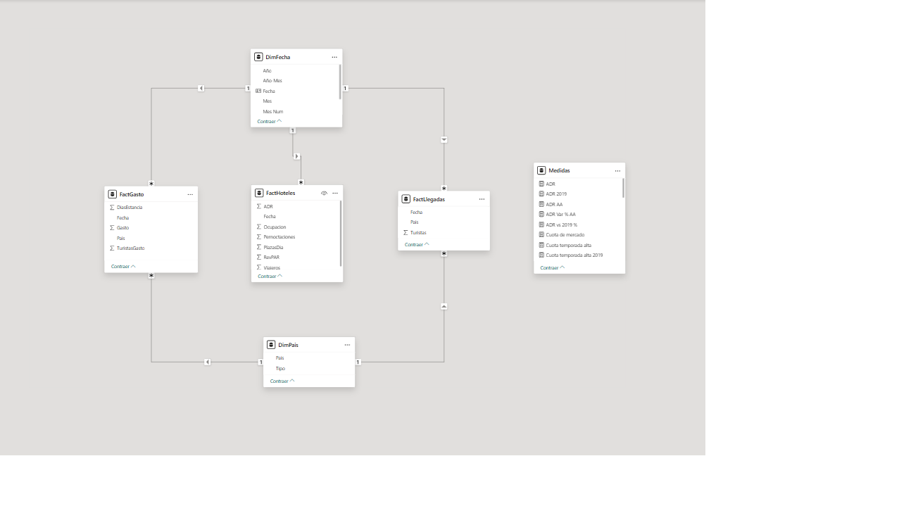

# Turismo en Baleares: recuperación tras el COVID (Power BI)

Informe de Power BI que analiza cómo se ha recuperado el turismo en las Illes Balears desde 2019, de qué mercados depende y cómo rinden los hoteles a lo largo del año. Construido con datos oficiales del IBESTAT y del INE (enero 2019 – septiembre 2026).

**Pregunta de negocio:** ¿cómo se ha recuperado el turismo en Baleares tras el COVID, de qué mercados depende y cómo rinden los hoteles a lo largo del año?



▶️ [Ver el vídeo del informe (75 s)](video/Turismo_Baleares_demo_v2.mp4) · 📄 [Informe completo en PDF](Turismo_Baleares_Power_BI.pdf)

---

## Principales hallazgos (2025 frente a 2019)

1. **El turismo ha superado el nivel prepandemia:** 19,05 millones de turistas (+15,7 %) y 23.363 M€ de gasto (+42,2 %, en términos nominales).
2. **Menos dependencia de los mercados tradicionales:** Alemania y Reino Unido pasan del 49,9 % al 44,6 % de los turistas. Reino Unido sigue un 3,3 % por debajo de 2019, mientras Francia crece un 69 %.
3. **La temporada se alarga:** marzo, abril, octubre y noviembre crecen un 25,8 %, casi el doble que mayo-octubre (+14,2 %). La ocupación hotelera de febrero pasa del 45 % al 56 %.
4. **La recuperación hotelera es de precio, no de volumen:** la ocupación apenas varía (+0,6 puntos, 76,8 %), pero el ADR sube un 49 % y el RevPAR un 53 %.

## Páginas del informe

| Página | Pregunta que responde | Captura |
| --- | --- | --- |
| 1. Resumen | ¿Se ha recuperado el turismo? | [Ver](capturas/01_Resumen.png) |
| 2. Mercados y gasto | ¿De qué mercados dependemos y cuáles crecen? | [Ver](capturas/02_Mercados%20y%20gasto.png) |
| 3. Estacionalidad | ¿Se está alargando la temporada? | [Ver](capturas/03_Estacionalidad.png) |
| 4. Hoteles | ¿Cómo rinden los hoteles a lo largo del año? | [Ver](capturas/04_Hoteles.png) |
| 5. Conclusiones | ¿Qué haría un negocio con estos datos? | [Ver](capturas/05_Conclusiones.png) |

## Datos

Seis archivos mensuales de Illes Balears, descargados el 30/10/2026.

| Archivo | Fuente | Contenido |
| --- | --- | --- |
| Llegadas de turistas por país | IBESTAT | Turistas por lugar de residencia |
| Gasto por país | IBESTAT | Gasto total, por persona y por persona y día |
| Viajeros y pernoctaciones | INE – Encuesta de ocupación hotelera | Viajeros y pernoctaciones en hoteles |
| Grado de ocupación por plazas | INE – Encuesta de ocupación hotelera | Ocupación (%) |
| ADR | INE – Indicadores de rentabilidad del sector hotelero | Tarifa media diaria (€) |
| RevPAR | INE – Indicadores de rentabilidad del sector hotelero | Ingreso por habitación disponible (€) |

Los archivos originales están en la carpeta `datos_brutos`, sin modificar: toda la limpieza se hace en Power Query.

## Proceso

### 1. Limpieza en Power Query
- Eliminación de cabeceras de informe, notas, totales anuales y agregados ("Mundo") que duplicarían las sumas.
- Conversión de periodos (`08/2026`, `2026M08`) a fechas reales y de números con formato español (`1.899.566`, `90,28`) mediante configuración regional.
- **Homogeneización de mercados:** llegadas y gasto usan desgloses de países distintos, así que se unificaron en 9 mercados comunes (España, Alemania, Reino Unido, Francia, Italia, Suiza, Países Nórdicos, Benelux y Resto del mundo).
- Las cuatro tablas del INE se prepararon como consultas intermedias y se combinaron por fecha en una sola tabla de hoteles.
- Cada paso está renombrado y documentado.

### 2. Modelo de datos

Modelo en constelación: tres tablas de hechos que comparten dos dimensiones. Todas las relaciones son de uno a varios y filtran en una sola dirección.



| Tabla | Granularidad | Se relaciona con |
| --- | --- | --- |
| FactLlegadas | mes × mercado | DimFecha, DimPais |
| FactGasto | mes × mercado | DimFecha, DimPais |
| FactHoteles | mes (total Baleares) | DimFecha |

### 3. Medidas DAX

**Medias ponderadas, no promedios de meses.** La ocupación anual se calcula como pernoctaciones entre plazas disponibles, no como la media de los 12 porcentajes mensuales:

```dax
Ocupación = DIVIDE ( [Pernoctaciones], SUM ( FactHoteles[PlazasDia] ) )
```

Con un promedio simple, la ocupación de 2019 saldría 62,45 % en lugar de 76,17 %.

**Comparaciones del mismo periodo.** 2026 está incompleto, así que las comparaciones toman solo los meses con datos y los buscan en el año anterior o en 2019:

```dax
Turistas AA =
VAR Periodos = SUMMARIZE ( FactLlegadas, DimFecha[Año], DimFecha[Mes Num] )
VAR PeriodosAA = SELECTCOLUMNS ( Periodos, "Año", DimFecha[Año] - 1, "Mes", DimFecha[Mes Num] )
RETURN CALCULATE ( [Turistas], REMOVEFILTERS ( DimFecha ), TREATAS ( PeriodosAA, DimFecha[Año], DimFecha[Mes Num] ) )
```

## Notas metodológicas

- El gasto medio por turista se calcula con la base de la propia encuesta de gasto, no con las llegadas, porque las clasificaciones de mercados no coinciden.
- Vacío = dato no publicado por la fuente; 0 = sin actividad (confinamiento de abril-mayo de 2020).
- La suma de mercados difiere del total oficial de IBESTAT en torno a un 0,1 % por redondeos de la fuente.
- Los importes (gasto, ADR, RevPAR) son nominales, sin descontar la inflación.
- 2026 incluye datos hasta agosto (IBESTAT) y septiembre (INE).

## Validación

Las cifras se comprobaron con valores de control calculados por otra vía a partir de los archivos originales: totales anuales, número de filas tras cada transformación y cruces entre fuentes (por ejemplo, los turistas deducidos del archivo de gasto coinciden con los del archivo de llegadas).

## Estructura del repositorio

```
├── Turismo_en_Baleares.pbix          Informe de Power BI
├── Turismo_Baleares_Power_BI.pdf     Informe exportado a PDF
├── capturas/                         Capturas de las 5 páginas y del modelo
├── video/                            Vídeo de demostración
└── datos_brutos/                     Archivos originales de IBESTAT e INE
```

## Cómo abrirlo

1. Descarga `Turismo_en_Baleares.pbix` y ábrelo con [Power BI Desktop](https://www.microsoft.com/es-es/power-platform/products/power-bi/desktop) (gratuito).
2. El informe ya contiene los datos. Para actualizarlos, descarga la carpeta `datos_brutos` y, en Power BI, ve a *Transformar datos → Configuración de origen de datos → Cambiar origen* para apuntar a tu carpeta.

## Próximos pasos

- Deflactar los importes con el IPC para separar crecimiento real de inflación.
- Añadir datos por isla y por zona turística.
- Publicarlo en Power BI Service con actualización programada.

## Autora

**Alba Pol Reyes** · Economista con experiencia en finanzas, terminando un Máster en Business Intelligence (UNIR).

[LinkedIn](https://www.linkedin.com/in/alba-pol-reyes-5bb12b291/) · [GitHub](https://github.com/albapol)
